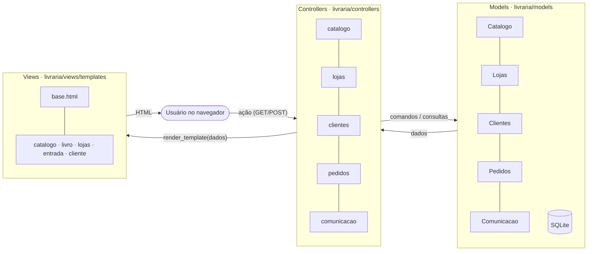

# Livraria — Exercícios 7.1 e 7.2 (Arquitetura de Software / MVC)

Refatoração do MVP da livraria do [exercício 6](https://github.com/HenriqueRSouza/livraria-sdd-exercicio-6) para o padrão **Model–View–Controller**, mantendo o front-end funcional e todas as regras da especificação ([docs/specs/livraria.md](docs/specs/livraria.md)). O histórico Git começa no exercício 6 e mostra a refatoração em commits separados.

- **Exercício 7.1 — Design de arquitetura:** [docs/arquitetura.md](docs/arquitetura.md) (contexto, containers, módulos, fluxo de reserva e decisões, em diagramas Mermaid).
- **Exercício 7.2 — Arquitetura MVC:** código em [`livraria/`](livraria).

## Arquitetura MVC



| Camada | Pasta | Responsabilidade | Não pode |
|---|---|---|---|
| **Model** | `livraria/models/` | Regras R01–R06 e acesso ao SQLite, divididos por módulo (`catalogo`, `lojas`, `clientes`, `pedidos`, `comunicacao`). `Modelos` reúne todos sobre o mesmo banco. | importar Flask, controllers ou views |
| **View** | `livraria/views/` | Templates Jinja (um por página, herdando de `base.html`) e formatação (`reais`). | acessar banco ou models |
| **Controller** | `livraria/controllers/` | Um blueprint Flask por módulo: lê parâmetros/formulários e sessão, chama o model, escolhe a view ou redireciona com mensagem. | executar SQL |

`livraria/__init__.py` (`create_app`) liga as três partes: instancia os models, registra os blueprints e o filtro de view, e trata `RegraInvalida` exibindo a mensagem ao usuário. Essas regras de dependência são verificadas em `tests/test_arquitetura.py`.

### O que mudou em relação ao exercício 6

| Antes (exercício 6) | Depois (MVC) |
|---|---|
| `livraria.py`: uma classe `Livraria` com todas as regras e SQL | `livraria/models/`: cinco models coesos + `banco.py` (conexão, esquema, dados de exemplo) |
| `app.py`: todas as rotas em uma função | `livraria/controllers/`: cinco blueprints; `app.py` só inicia o servidor |
| `templates/index.html`: um template com `if pagina == ...` | `livraria/views/templates/`: `base.html` + uma view por página |

URLs, regras e dados de exemplo continuam os mesmos; os testes do exercício 6 foram mantidos (ajustados para os novos models) e passam sem alteração de comportamento.

## Instalar e executar

Requer Python **3.10+** e pip. Na pasta deste projeto:

```sh
python3 -m venv .venv
.venv/bin/python -m pip install -r requirements.txt
.venv/bin/python -m unittest discover -v
.venv/bin/python app.py
```

Abra **http://127.0.0.1:5000/**. Na primeira execução, `livraria.db` é criado e preenchido com 2 livros, 3 edições e 2 lojas de exemplo. Para recomeçar, remova `livraria.db` com o servidor parado, ou use outro banco: `LIVRARIA_DB=/caminho/novo.db .venv/bin/python app.py`.

## Percurso da interface

1. No **Catálogo**, pesquise por título/autor/gênero e abra **A Casa das Marés**: edições, preço promocional, avaliação e estoque por loja/seção.
2. Em **Lojas**, filtre por bairro.
3. Em **Cadastro / entrada**, cadastre-se com interesse `Ficção` e veja recomendação e aviso de promoção em **Minha área**.
4. Reserve um exemplar (código `RES-...`), depois retire com o código ou cancele; acompanhe histórico e pontos.
5. Em uma edição esgotada, peça aviso de reposição e use **Simular +1 no estoque**; a notificação aparece em **Minha área**.

## Limites da demonstração

Pagamentos, retirada e notificações são simulações locais (sem cobrança, email, push ou GPS). A sessão é identificada pelo email cadastrado, sem senha.

## Testes

`.venv/bin/python -m unittest discover -v` executa:

- `tests/test_models.py` — critérios C01–C07 direto nos models;
- `tests/test_http.py` — C08, navegação HTTP pelos controllers e views;
- `tests/test_arquitetura.py` — regras de dependência do MVC.
