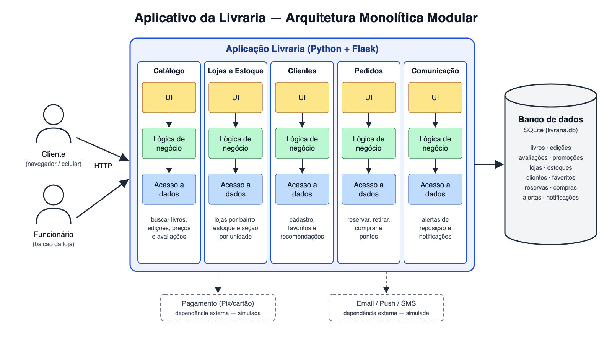

# Exercício 7.1 — Design de Arquitetura

Arquitetura escolhida para o aplicativo da livraria: **monolítica modular**.

## Componentes

A aplicação é um único programa Python/Flask dividido em 5 módulos. Cada módulo tem sua UI, sua lógica de negócio e seu acesso a dados.

| Módulo | O que faz |
|---|---|
| Catálogo | busca de livros, edições, preços, promoções e avaliações |
| Lojas e Estoque | lojas por bairro, estoque e seção de cada unidade |
| Clientes | cadastro, favoritos e recomendações |
| Pedidos | reserva, retirada com código, compra e pontos de fidelidade |
| Comunicação | alertas de reposição e notificações |

## Como os componentes se comunicam

- O cliente (navegador ou celular) e o funcionário da loja acessam a aplicação por **HTTP**.
- Os módulos conversam por **chamadas diretas de métodos**, em memória e sem tráfego de rede. Por exemplo, Pedidos consulta o preço no Catálogo e baixa o estoque em Lojas.
- Todos usam o **mesmo banco SQLite**, com as tabelas separadas por módulo.
- **Dependências externas:** pagamento e envio de email/push. Na demonstração, as duas são simuladas.

## Por que monolítica modular

- O projeto é pequeno e a equipe é reduzida, então um único executável é mais simples de rodar e de testar.
- Os módulos ficam separados por assunto e já poderiam virar microsserviços no futuro.
- Desvantagem: a aplicação escala como um bloco só e tudo usa a mesma tecnologia.
