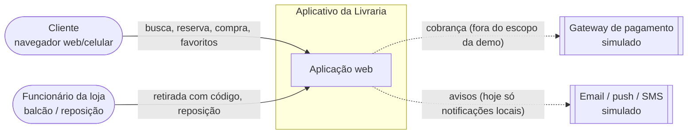
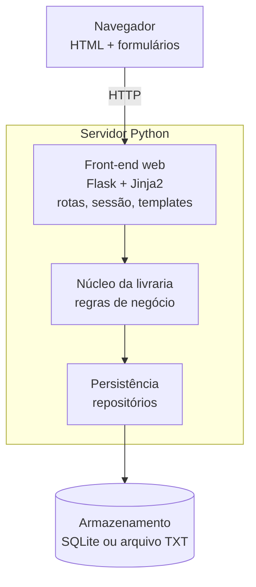
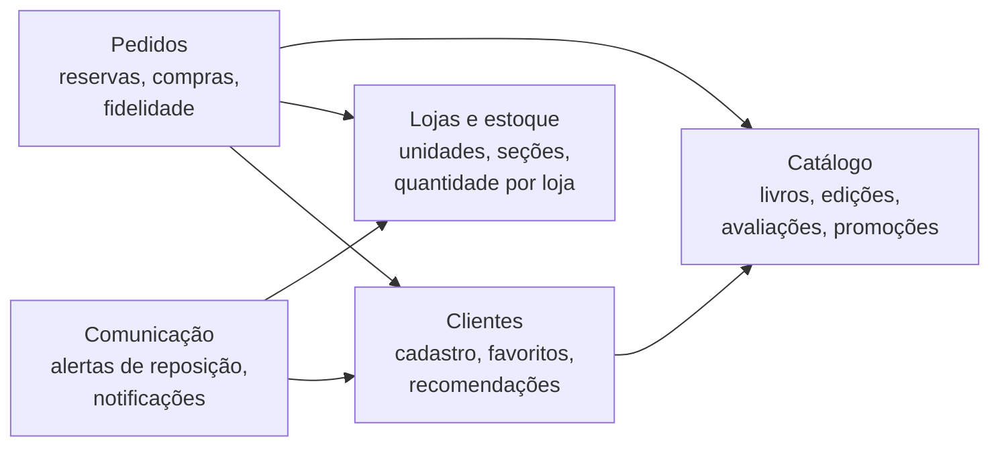
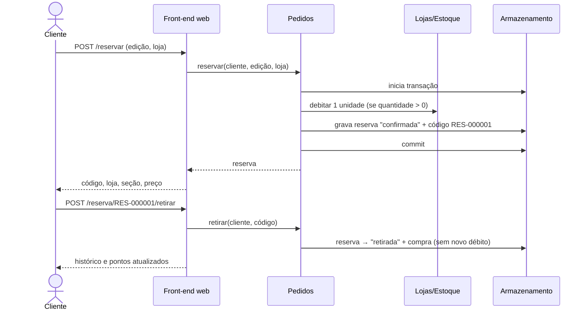

# Exercício 7.1 — Design de arquitetura do aplicativo da livraria

Este documento desenha a arquitetura de software do aplicativo da livraria especificado em [specs/livraria.md](specs/livraria.md). Ele serve de referência para as implementações dos exercícios 7.2 (MVC), 7.3 (multicamadas) e 7.4 (Clean).

## 1. Contexto

Quem usa o sistema e com o que ele conversa.

Integrações externas aparecem tracejadas: na demonstração elas são simuladas localmente (sem cobrança real nem envio de mensagens), mas a arquitetura reserva o ponto de extensão para elas.

## 2. Containers

| Container | Responsabilidade | Tecnologia |
|---|---|---|
| Front-end web | Renderizar páginas, ler formulários, manter sessão do cliente, mostrar mensagens | Flask 3, Jinja2 |
| Núcleo | Regras R01–R06: busca, preço promocional, reserva/retirada/cancelamento, pontos, alertas | Python puro |
| Persistência | Ler/gravar entidades com transações atômicas (estoque não pode ficar negativo) | SQLite (7.2, 7.3) / TXT (7.4) |

## 3. Módulos do núcleo

Cada módulo é dono das suas tabelas/registros. Pedidos consultam o preço no catálogo e debitam estoque em lojas dentro da mesma transação, o que garante R05 (último exemplar não é vendido duas vezes).

## 4. Fluxo principal: reservar e retirar

## 5. Decisões de arquitetura

| Decisão | Motivo |
|---|---|
| Monólito modular em vez de microsserviços | Uma equipe, um banco pequeno e transações que cruzam estoque e pedidos; dividir em serviços agora traria rede e consistência eventual sem benefício. Os módulos da seção 3 são as fronteiras naturais se um dia forem separados. |
| Renderização no servidor (Jinja) | Front-end funcional sem build de JavaScript; formulários HTML cobrem todas as ações. |
| Núcleo sem dependência de Flask | Permite testar regras sem HTTP e trocar a interface. É o ponto que 7.2 → 7.3 → 7.4 vai reforçando. |
| Valores em centavos inteiros | Evita erro de arredondamento em preço, desconto e pontos. |
| Integrações externas simuladas | Escopo de demonstração; ficam atrás de uma fronteira para serem trocadas por serviços reais. |

## 6. Como cada exercício materializa este desenho

| Exercício | Estilo | Onde o desenho aparece |
|---|---|---|
| 7.2 | MVC | Models = núcleo + persistência por módulo; Views = templates Jinja; Controllers = blueprints Flask por módulo |
| 7.3 | Multicamadas (4 camadas) | Apresentação → Aplicação → Domínio e Dados (Dados só conhece as entidades do Domínio); nova feature: avaliações de clientes |
| 7.4 | Clean Architecture | Entidades ← Casos de uso (portas) ← Adaptadores (TXT) ← Frameworks (Flask); DIP isola o núcleo da tecnologia de armazenamento |
